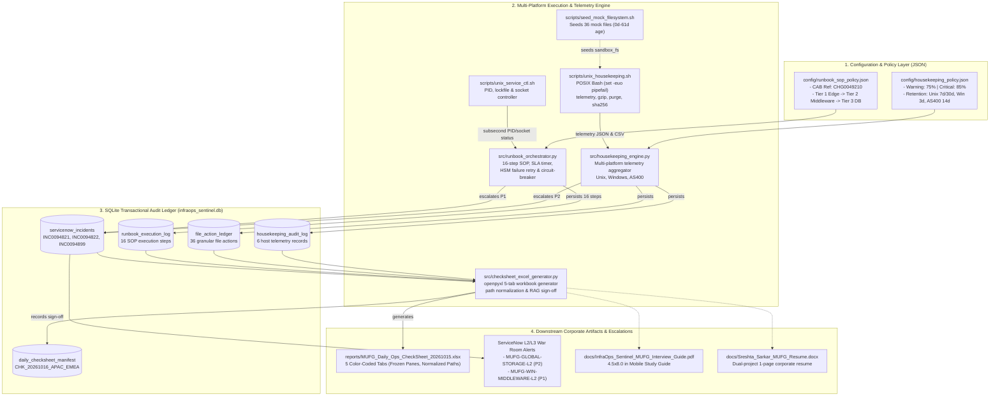
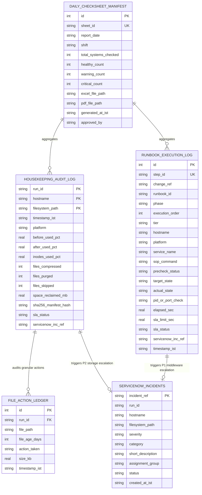

# 01. System Architecture & End-to-End Data Flow
**Project:** `InfraOps-Sentinel` (System Housekeeping, Start/Shutdown Runbook Orchestrator & Excel Check-Sheet Engine)  
**Target Profile:** Senior Banking Infrastructure & Production Operations Engineer  
**MUFG Requisition:** `10078906-WD` (Operation Analyst)  
**Author:** Sreshta Sarkar  

---

## 1. Executive Blueprint & MUFG JD Alignment

In mission-critical banking environments such as **MUFG Bank, Ltd.**, production operations analysts are tasked with maintaining high-availability (99.999% SLA) infrastructure across legacy mainframe, distributed Unix, and enterprise Windows tiers. The core mandate of **Requisition 10078906-WD** explicitly demands:

> *"System housekeeping, shutdown and start in accordance with defined procedures and SLAs; Complete daily check sheet and reporting."*

`InfraOps-Sentinel` was built from the ground up to automate and prove this exact tripartite mandate through three interconnected, audited production modules:

| MUFG JD Requirement | Operational Risk Addressed | `InfraOps-Sentinel` Implementation Module | Ground-Truth Artifact / Verification |
| :--- | :---: | :--- | :--- |
| **System Housekeeping** | Log partition saturation, inode depletion, core banking transaction halts, unmanaged crash dumps. | **Phase 1: Multi-Platform Housekeeping & Storage SLA Engine** | `housekeeping_engine.py`<br/>`unix_housekeeping.sh`<br/>Reclaimed `27.09 MB` across 6 nodes. |
| **System Shutdown & Start** | Out-of-order component stops, in-flight transaction loss, database ledger corruption, upstream traffic blackholing. | **Phase 2: SOP-Driven Maintenance Window Orchestrator** | `runbook_orchestrator.py`<br/>`unix_service_ctl.sh`<br/>16 steps under CAB `CHG0049210`. |
| **Daily Check Sheet & Reporting** | Inaccurate shift handovers, unrecorded SLA breaches, regulatory non-compliance (J-SOX / JFSA). | **Phase 3: Multi-Tab Corporate Excel Check-Sheet Engine** | `checksheet_excel_generator.py`<br/>5-tab `.xlsx` with frozen panes & digital signatures. |

---

## 2. End-to-End System Architecture Diagram

The entire `InfraOps-Sentinel` ecosystem connects policy definitions, low-level POSIX/shell utilities, Python orchestration logic, an audited SQLite database, and downstream executive artifacts:



---

## 3. SQLite Database Schema & Entity-Relationship Architecture

The repository enforces structured persistence in `data/infraops_sentinel.db` managed by `src/db_manager.py`. All database operations execute under SQLite `WAL` (Write-Ahead Logging) mode with explicit foreign keys enabled.



### Why SQLite Schema Design Matters in Banking Operations
1. **Deterministic Auditability:** Every file action (`COMPRESSED_GZ`, `PURGED_RETENTION`, `SKIPPED_ACTIVE`) is individually recorded with byte-level sizes and timestamps. Regulators can reconcile every megabyte claimed as reclaimed back to a specific file inode.
2. **Crash-Resistant WAL Persistence:** Banking runbooks cannot rely on volatile memory. If an orchestration agent is terminated mid-flight, SQLite Write-Ahead Logging preserves all previous steps up to the exact millisecond of failure.
3. **Compound Primary Keys:** In `housekeeping_audit_log`, `(run_id, hostname, filesystem_path)` prevents duplicate telemetry submissions during automated retry sweeps.

---

## 4. Repository File-by-File Technical Directory Map

```text
./infraops-sentinel/
├── README.md                                    # Comprehensive system documentation & architecture guide
├── run_all.sh                                   # Master single-command orchestration script (set -euo pipefail)
│
├── config/
│   ├── housekeeping_policy.json                 # SLA thresholds (75%/85%), platform paths, retention intervals
│   └── runbook_sop_policy.json                  # CAB Change CHG0049210, dependency tiers, shutdown/startup SLAs
│
├── data/
│   ├── infraops_sentinel.db                     # Production SQLite database (5 indexed relational tables)
│   ├── ledger_mufg-rhel-core01_*.csv            # CSV audit output generated by unix_housekeeping.sh
│   ├── ledger_mufg-rhel-batch02_*.csv           # CSV audit output for batch partition
│   ├── telemetry_mufg-rhel-core01_*.json        # Low-level JSON telemetry from Bash engine
│   └── telemetry_mufg-rhel-batch02_*.json
│
├── docs/
│   ├── InfraOps_Sentinel_MUFG_Interview_Guide.pdf # 4.5 x 8.0 in mobile pocket study guide
│   ├── Sreshta_Sarkar_MUFG_Resume.docx          # Recruiter-calibrated 1-page resume with both projects
│   └── study_notes/                             # 5 exhaustive technical study notes (this directory)
│
├── reports/
│   ├── MUFG_Daily_Ops_CheckSheet_20261015.xlsx  # 5-tab corporate Excel daily operations check-sheet
│   └── MUFG_Daily_Ops_CheckSheet_20261016.xlsx  # Multi-shift archive check-sheet
│
├── sandbox_fs/                                  # Realistic multi-platform mock filesystem
│   ├── as400_qsysprt/
│   │   ├── QSYSPRT/                             # Spool output queues (.SPL) and job logs (.LOG)
│   │   └── QSYS_LIB/                            # System ASP 1 journal receivers (.JRN)
│   ├── run/                                     # Mock runtime daemon directory (.pid, .lock, .listener)
│   ├── var/log/
│   │   ├── mufg_app/                            # Core banking live logs, aged logs, core dumps
│   │   └── mufg_batch/                          # Settlement daemon logs, lockfiles, sort scratch
│   └── win_temp_dump/
│       ├── C_Temp_Dump/                         # Windows IIS crash minidumps (.dmp) and temp files
│       └── D_SQLData/                           # SQL database files (.mdf, .ndf, .ldf) and diff backups
│
├── scripts/
│   ├── build_resume.py                          # python-docx resume compiler
│   ├── generate_mobile_guide.py                 # reportlab mobile pocket guide compiler
│   ├── seed_mock_filesystem.sh                  # Deterministic backdated filesystem generator (0d-61d)
│   ├── unix_housekeeping.sh                     # Low-level POSIX Bash filesystem & inode engine
│   └── unix_service_ctl.sh                      # Mock daemon lifecycle & latency simulator
│
└── src/
    ├── __init__.py                              # Python package initializer
    ├── db_manager.py                            # SQLite schema manager, table migrations & query API
    ├── housekeeping_engine.py                   # Phase 1 multi-platform Python orchestrator
    ├── runbook_orchestrator.py                  # Phase 2 3-stage maintenance window SOP engine
    └── checksheet_excel_generator.py            # Phase 3 openpyxl 5-tab corporate check-sheet engine
```

---

## 5. Master Pipeline Execution (`run_all.sh`) Walkthrough

The master orchestration script [run_all.sh](file:///home/zarakari/Downloads/srestha_resume/project%202/infraops-sentinel/run_all.sh) ties the entire system together into a single, idempotent, automated execution chain:

```bash
#!/usr/bin/env bash
set -euo pipefail

# 1. Step 0: Sandbox Initialization
rm -f ./data/infraops_sentinel.db
./scripts/seed_mock_filesystem.sh

# 2. Step 1: Storage Housekeeping & Telemetry
./venv/bin/python3 src/housekeeping_engine.py

# 3. Step 2: SOP Start/Shutdown & Failure Injection
./venv/bin/python3 src/runbook_orchestrator.py

# 4. Step 3: Excel Corporate Check-Sheet Compilation
./venv/bin/python3 src/checksheet_excel_generator.py
```

### Execution Telemetry Flow
1. **Zero-State Initialization:** Any residual SQLite locks or dirty test files are cleared. `seed_mock_filesystem.sh` writes 36 deterministic files with backdated timestamps ranging from 0 days (touched today) to 61 days ago using `touch -d`.
2. **Phase 1 Execution:** `housekeeping_engine.py` invokes `unix_housekeeping.sh` on RHEL partitions and executes platform-native retention rules on Windows and AS400 partitions. Total storage reclaimed: **`27.09 MB`**. Two hosts (`mufg-win-pay01` at 87.7% and `mufg-as400-prd02` at 91.0%) breach the 85% Critical SLA and automatically generate ServiceNow P2 tickets (`INC0094821`, `INC0094822`).
3. **Phase 2 Execution:** `runbook_orchestrator.py` initiates change window `CHG0049210`. It executes Stage A ordered shutdown (`Tier 1 -> Tier 2 -> Tier 3`), verifies Stage B maintenance gate, and executes Stage C startup (`Tier 3 -> Tier 2 -> Tier 1`). It captures an injected HSM timeout on `mufg-win-pay01` (48.4s/49.1s > 45s SLA), circuit-breaks Tier 1 SWIFT Gateway startup (`HALTED_DEPENDENCY_BLOCK`), and raises ServiceNow P1 incident `INC0094899`.
4. **Phase 3 Execution:** `checksheet_excel_generator.py` queries all 5 SQLite tables, normalizes all sandbox paths into canonical enterprise paths, formats 5 color-coded tabs with frozen panes, and registers manifest `CHK_20261016_APAC_EMEA` in SQLite.

---

## 6. Interview Insights & Production Best Practices

> 💡 **Interview Insight: Describing System Architecture**  
> *"When interviewing for an Operation Analyst role at MUFG, do not describe scripts as isolated one-off cron jobs. Describe them as an **integrated observability and orchestration pipeline**. Highlight that your architecture enforces separation of concerns: JSON policies define business SLAs, Bash handles kernel-level filesystem and socket inspections, Python coordinates multi-platform state machines, SQLite provides an unalterable audit ledger, and OpenPyXL generates the regulatory shift handover artifact."*

> ⚠️ **Banking Production Pitfall: Unaudited Cleanup**  
> *In Japanese financial institutions governed by the JFSA (Financial Services Agency) and J-SOX, deleting files without an unalterable audit trail is a major compliance finding. If an auditor asks 'Who authorized purging `core_banking_txn_20260825.log.gz`?', InfraOps-Sentinel provides the exact run ID (`HKP_20261017_064409`), policy rule (Retention > 30 days), pre-purge size (`0.9 KB`), and SHA-256 manifest hash.*

