# 03. Phase 2: SOP Runbook Orchestration & Circuit-Breaker Deep Dive
**Project:** `InfraOps-Sentinel`  
**Focus:** Maintenance Window Automation, Dependency Tiers, Failure Injection & Upstream Circuit-Breaking  
**Relevant Code:** `config/runbook_sop_policy.json`, `scripts/unix_service_ctl.sh`, `src/runbook_orchestrator.py`  
**CAB Change Reference:** `CHG0049210` (Monthly Patching & IPL Maintenance Window)  
**Author:** Sreshta Sarkar  

---

## 1. Banking Maintenance Windows & The Dependency Dilemma

In global corporate and investment banks like **MUFG**, planned maintenance windows (such as OS security patching, database index reorganization, and mainframe Initial Program Load - IPL) require coordinated shutdowns and startups of dozens of interconnected services.

A critical failure pattern in financial infrastructure operations is **Dependency Inversion**:
- If an engineer brings down the database (Tier 3) while the edge gateway (Tier 1) is still open, external financial messages (e.g., SWIFT MT103 wire transfers, ISO 20022 `pacs.008` payment instructions) will flood into memory queues, fail to persist, and cause massive duplicate transaction risks or message drops.
- Conversely, during system startup, if the edge gateway opens before the payment engine or ledger databases are online, customer requests will hit dead endpoints, triggering false circuit breaks and severe regulatory non-compliance.

`InfraOps-Sentinel` eliminates human error by enforcing a strict **Top-Down Shutdown** and **Bottom-Up Startup** dependency model.

---

## 2. Dependency Hierarchy Diagram: Top-Down vs. Bottom-Up

```mermaid
flowchart TB
    subgraph ShutdownFlow ["STAGE A: TOP-DOWN SHUTDOWN (Tier 1 -> Tier 2 -> Tier 3)"]
        direction TB
        S1["Step 1-2: TIER 1 (Edge Ingress)<br/>mufg-rhel-core01: mufg-swift-gateway.service<br/>Pre-check: Drain sockets (:8443 == 0) | systemctl stop (SLA: 30s)"]
        S2["Step 3-6: TIER 2 (Middleware & Batch Processing)<br/>mufg-win-pay01: MUFG_ISO20022_PaymentEngine (MSMQ=0 | Stop-Service, SLA: 45s)<br/>mufg-rhel-batch02: mufg-settlement-daemon (PID lock=0 | systemctl stop, SLA: 30s)"]
        S3["Step 7-10: TIER 3 (Core Subsystems & General Ledger)<br/>mufg-as400-core01: QBATCH & QINTER (Drain tellers | ENDSBS *CNTRLD, SLA: 90s)<br/>mufg-as400-prd02: MUFGCORE (Sync journals | ENDSBS *CNTRLD, SLA: 90s)"]
        S1 -->|Ingress Drained| S2
        S2 -->|Queues Flushed| S3
    end

    subgraph GateCheck ["STAGE B: MAINTENANCE GATE CHECK"]
        G["Verification Gate: All 5 Subsystems Verified STOPPED<br/>Execute OS Patching, PTF Upgrades, and Hardware Firmware Updates"]
    end

    subgraph StartupFlow ["STAGE C: BOTTOM-UP STARTUP (Tier 3 -> Tier 2 -> Tier 1)"]
        direction TB
        U1["Step 11-12: TIER 3 (Start Core Banking Ledger First)<br/>mufg-as400-core01: STRSBS QBATCH/QINTER (SLA: 90s)<br/>mufg-as400-prd02: STRSBS MUFGCORE (SLA: 90s)"]
        U2["Step 13: TIER 2 (Start Settlement Daemons)<br/>mufg-rhel-batch02: systemctl start settlement (SLA: 30s)"]
        U3["Step 14-15: TIER 2 (Start Payment Middleware - FAILS)<br/>mufg-win-pay01: Start-Service ISO20022<br/>Attempt 1: 48.4s > 45s (HSM Fail) | Retry: 49.1s > 45s (FAILED)"]
        U4["Step 16: TIER 1 (CIRCUIT-BREAKER ACTIVATED)<br/>mufg-rhel-core01: mufg-swift-gateway HALTED<br/>Prevent live traffic while backend is inoperable!"]
        U1 -->|Databases Online| U2
        U2 -->|Daemons Online| U3
        U3 -.->|SLA BREACHED: P1 INC0094899| U4
    end

    ShutdownFlow --> GateCheck
    GateCheck --> StartupFlow
```



---

## 3. Startup Failure, SOP Retry & Circuit-Breaker State Machine

The sequence below illustrates the controlled failure injection, automated SOP retry, P1 incident escalation, and upstream circuit-breaker execution during Stage C startup:

```mermaid
sequenceDiagram
    autonumber
    participant Orch as RunbookOrchestrator (src/runbook_orchestrator.py)
    participant WinNode as mufg-win-pay01 (Windows Server 2022)
    participant HSM as Hardware Security Module (Thales/SafeNet Port 9443)
    participant SNOW as ServiceNow (MUFG-WIN-MIDDLEWARE-L2)
    participant Gateway as mufg-rhel-core01 (SWIFT Edge Gateway)
    participant DB as SQLite (runbook_execution_log)

    Note over Orch,Gateway: Tier 3 (AS400) and Batch Daemons already STARTED_VERIFIED
    
    Orch->>WinNode: Step 14: Start-Service -Name 'MUFG_ISO20022_PaymentEngine'
    WinNode->>HSM: Initiate Cryptographic Handshake (TLS Mutual Auth on :9443)
    Note over WinNode,HSM: HSM Crypto Handshake Times Out (No response from cluster)
    WinNode-->>Orch: Health Check Failed: ERROR_PORT_9443_TIMEOUT (Elapsed: 48.4s vs 45s SLA)
    
    Orch->>DB: Log Step 14 as SLA_BREACHED (Attempt #1)
    Note over Orch: SOP Policy Rule: Allow 1 Automated SOP Restart Retry
    
    Orch->>WinNode: Step 15: Restart-Service -Force ; Test-NetConnection -Port 9443
    WinNode->>HSM: Retry HSM Handshake
    Note over WinNode,HSM: Second Handshake Timeout (Elapsed: 49.1s vs 45s SLA)
    WinNode-->>Orch: Health Check Failed: FAILED_SLA_BREACH
    
    Orch->>DB: Log Step 15 as SLA_BREACHED (Attempt #2)
    
    Orch->>SNOW: Raise P1 Critical Incident: INC0094899
    Note over Orch,SNOW: Assignment: MUFG-WIN-MIDDLEWARE-L2<br/>Bridge Line: MUFG-INCIDENT-WAR-ROOM-01<br/>Linked Change: CHG0049210
    
    Orch->>Orch: Evaluate Upstream Dependencies (Tier 1 depends on Tier 2)
    
    Orch->>Gateway: Step 16: CIRCUIT-BREAKER ENFORCED: HALTED_DEPENDENCY_BLOCK
    Note over Gateway: SWIFT Alliance Gateway held in STOPPED state.<br/>Ingress Port :8443 remains closed to protect live traffic.
    
    Orch->>DB: Log Step 16 as HALTED_UPSTREAM (Linked to INC0094899)
```

---

## 4. Complete 16-Step Runbook Audit Log Reference

Every step executed under runbook ID **`RBK_SOP_20261017_064410`** was captured with millisecond precision and committed to SQLite:

| Order | Phase | Tier | Target Hostname | Target Service / Component | SOP Command Executed | Actual State | Elapsed | SLA Limit | SLA Status | Ticket Ref |
| :---: | :---: | :---: | :--- | :--- | :--- | :--- | :---: | :---: | :---: | :---: |
| **1** | `PRE_CHECK` | Tier 1 | `mufg-rhel-core01` | `mufg-swift-gateway.service` | `ss -tan \| grep :8443 \| wc -l` | `ACTIVE_DRAINED` | 1.25s | 10.0s | `COMPLIANT` | - |
| **2** | `SHUTDOWN` | Tier 1 | `mufg-rhel-core01` | `mufg-swift-gateway.service` | `systemctl stop mufg-swift-gateway` | `STOPPED_VERIFIED` | 4.82s | 30.0s | `COMPLIANT` | - |
| **3** | `PRE_CHECK` | Tier 2 | `mufg-win-pay01` | `MUFG_ISO20022_PaymentEngine` | `Get-MsmqQueue \| Measure-Object` | `MSMQ_EMPTY` | 2.14s | 15.0s | `COMPLIANT` | - |
| **4** | `SHUTDOWN` | Tier 2 | `mufg-win-pay01` | `MUFG_ISO20022_PaymentEngine` | `Stop-Service -Name ... -Force` | `STOPPED_VERIFIED` | 12.38s | 45.0s | `COMPLIANT` | - |
| **5** | `PRE_CHECK` | Tier 2 | `mufg-rhel-batch02` | `mufg-settlement-daemon.service`| `test ! -f /var/run/mufg_batch.pid`| `NO_ACTIVE_LOCK` | 0.85s | 10.0s | `COMPLIANT` | - |
| **6** | `SHUTDOWN` | Tier 2 | `mufg-rhel-batch02` | `mufg-settlement-daemon.service`| `systemctl stop mufg-settlement-daemon`| `STOPPED_VERIFIED` | 5.16s | 30.0s | `COMPLIANT` | - |
| **7** | `PRE_CHECK` | Tier 3 | `mufg-as400-core01` | `QBATCH & QINTER` | `WRKACTJOB SBS(QINTER) STATUS(*RUN)`| `ACTIVE_TELLERS=0` | 4.50s | 30.0s | `COMPLIANT` | - |
| **8** | `SHUTDOWN` | Tier 3 | `mufg-as400-core01` | `QBATCH & QINTER` | `ENDSBS SBS(QBATCH/QINTER) *CNTRLD` | `STOPPED_VERIFIED` | 42.60s | 90.0s | `COMPLIANT` | - |
| **9** | `PRE_CHECK` | Tier 3 | `mufg-as400-prd02` | `MUFGCORE` | `WRKJRN JRN(MUFGCORE/COREJRN)` | `JRN_SYNC_OK` | 3.82s | 30.0s | `COMPLIANT` | - |
| **10**| `SHUTDOWN` | Tier 3 | `mufg-as400-prd02` | `MUFGCORE` | `ENDSBS SBS(MUFGCORE) OPTION(*CNTRLD)` | `STOPPED_VERIFIED` | 38.20s | 90.0s | `COMPLIANT` | - |
| **11**| `STARTUP` | Tier 3 | `mufg-as400-core01` | `QBATCH & QINTER` | `STRSBS SBSD(QBATCH) ; STRSBS ...` | `STARTED_VERIFIED` | 34.20s | 90.0s | `COMPLIANT` | - |
| **12**| `STARTUP` | Tier 3 | `mufg-as400-prd02` | `MUFGCORE` | `STRSBS SBSD(MUFGCORE/MUFGCORE)` | `STARTED_VERIFIED` | 29.50s | 90.0s | `COMPLIANT` | - |
| **13**| `STARTUP` | Tier 2 | `mufg-rhel-batch02` | `mufg-settlement-daemon.service`| `systemctl start mufg-settlement-daemon`| `STARTED_VERIFIED` | 6.40s | 30.0s | `COMPLIANT` | - |
| **14**| `STARTUP` | Tier 2 | `mufg-win-pay01` | `MUFG_ISO20022_PaymentEngine` | `Start-Service -Name ...` | `ERROR_PORT_9443_TIMEOUT` | **48.40s** | 45.0s | `SLA_BREACHED` | - |
| **15**| `ROLLBACK`| Tier 2 | `mufg-win-pay01` | `MUFG_ISO20022_PaymentEngine` | `Restart-Service ; Test-NetConnection` | `FAILED_SLA_BREACH` | **49.10s** | 45.0s | `SLA_BREACHED` | `INC0094899` |
| **16**| `ROLLBACK`| Tier 1 | `mufg-rhel-core01` | `mufg-swift-gateway.service` | `HALTED_UPSTREAM_DEPENDENCY` | `HALTED_DEPENDENCY_BLOCK` | **0.00s** | 30.0s | `HALTED_UPSTREAM`| `INC0094899` |

---

## 5. Platform-Native Command Analysis & Banking Rationale

### A. IBM iSeries / AS400 Controlled Subsystem Termination (`*CNTRLD` vs. `*IMMED`)
In `scripts/runbook_orchestrator.py` and `config/runbook_sop_policy.json`, the shutdown command for AS400 subsystems is:
```cl
ENDSBS SBS(MUFGCORE) OPTION(*CNTRLD) DELAY(60)
```

> ⚠️ **The Immediate Shutdown Danger on AS400 (`OPTION(*IMMED)`):**  
> If an operator executes `ENDSBS SBS(MUFGCORE) OPTION(*IMMED)`, the operating system issues an immediate cancel to all running batch and database threads. Active record locks (`commitment control`) are forcibly rolled back, but unfinished index writes can leave database files in an **`INVALID / NEED REBUILD`** state. When the system restarts, it requires hours of rebuild time (`RCLSTG` - Reclaim Storage), causing massive SLA breaches!  
> 
> **Why `OPTION(*CNTRLD) DELAY(60)` is standard banking practice:**  
> It instructs OS/400 to signal active jobs that termination is requested. Jobs are granted up to **60 seconds** to complete their current unit of work, commit the open transaction block, close database files cleanly, and detach journal receivers before the subsystem terminates.

---

### B. Pre-Stop Socket Draining on Linux (`ss -tan`)
Rather than issuing an abrupt `kill` or `systemctl stop`, Step 1 executes:
```bash
ss -tan | grep :8443 | wc -l
```
- In high-throughput payment gateways, stopping a service while active TCP handshakes are in progress generates TCP RST packets back to correspondent banks (e.g. JPMorgan, Citi, or Bank of Japan), triggering partner-side network alarms.
- The pre-check ensures that traffic balancers (F5 BIG-IP) have successfully removed the node from the pool and existing sessions have drained to zero before `systemctl stop` is sent.

---

### C. MSMQ Queue Draining on Windows Server
On `mufg-win-pay01`, the payment transformation engine processes incoming payment messages through Microsoft Message Queuing (MSMQ):
```powershell
Get-MsmqQueue -Name 'mufg_iso20022_inbound' | Measure-Object -Property MessageCount -Sum
```
- Stopping the Windows service while messages are in memory can strand transactions in transactional dead-letter queues. Pre-checking queue depth ensures zero in-flight messages.

---

## 6. Interview Defense Tactics & War Room Scenarios

> 💡 **Interview Insight: Describing Upstream Dependency Protection**  
> *"When asked: 'How do you handle a scenario where a middle-tier service fails to come up during a maintenance window?', respond:  
> 'In InfraOps-Sentinel, we implemented an automated circuit-breaker pattern. During Change Window `CHG0049210`, when `mufg-win-pay01` failed its HSM crypto handshake verification across two attempts (exceeding the 45-second SLA limit at 48.4s and 49.1s), the orchestrator did NOT proceed to start the upstream Tier 1 SWIFT Gateway on `mufg-rhel-core01`. Instead, it automatically marked Step 16 as `HALTED_DEPENDENCY_BLOCK` to keep ingress port 8443 closed, raised P1 Incident `INC0094899` routed to `MUFG-WIN-MIDDLEWARE-L2`, and opened the technical war room bridge. This protected external correspondent banks from sending transactions into a black hole.'*"

