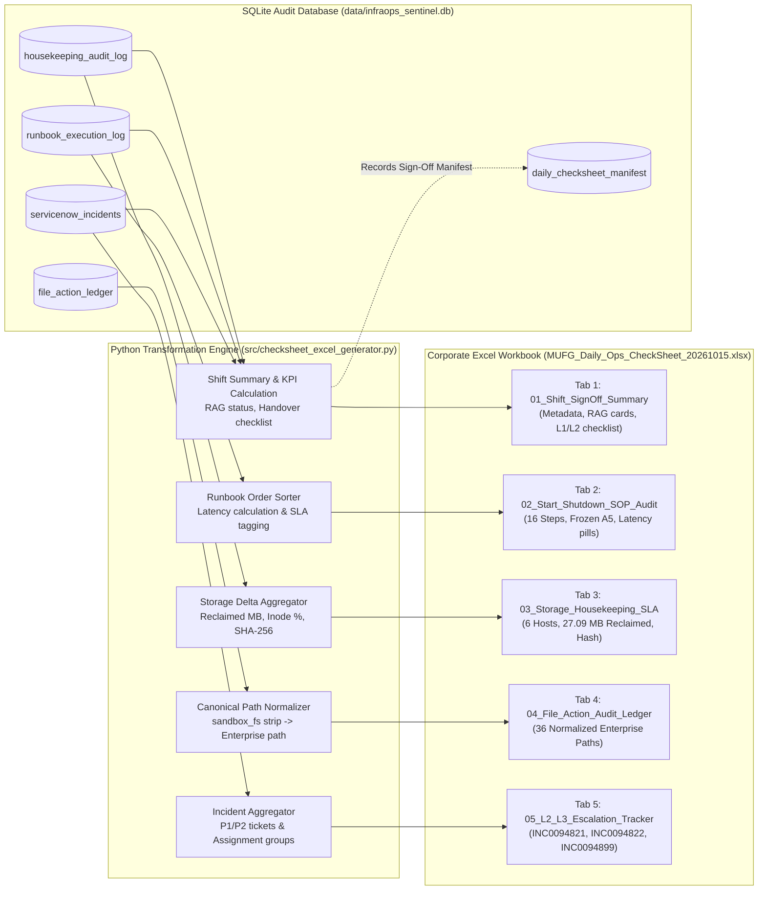
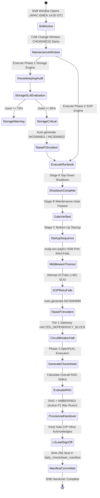

# 04. Phase 3: Corporate Excel Check-Sheet & Shift Handover Governance
**Project:** `InfraOps-Sentinel`  
**Focus:** Automated Multi-Tab Excel Generation, Shift Sign-Off Governance, Canonical Path Normalization & Regulatory Compliance  
**Relevant Code:** `src/checksheet_excel_generator.py`, `src/db_manager.py`  
**Output Report:** `reports/MUFG_Daily_Ops_CheckSheet_20261015.xlsx`  
**Author:** Sreshta Sarkar  

---

## 1. Daily Check-Sheets: The Backbone of Banking Operations

In international banking hubs (Tokyo, Singapore, London, New York), operations centers run on a **follow-the-sun 24x7x365** model. Shift handovers between regions (e.g. **APAC Morning to EMEA Afternoon**) represent high-vulnerability operational handoffs.

If an ongoing incident (such as an unmitigated storage breach or a halted SWIFT gateway) is not explicitly recorded, acknowledged, and signed off in the daily check-sheet:
1. The incoming shift assumes all infrastructure is healthy and may re-enable ingress gateways prematurely.
2. J-SOX (Japan Sarbanes-Oxley) and JFSA (Japanese Financial Services Agency) auditors will issue regulatory non-compliance citations for lack of operational governance and audit trail integrity.

`InfraOps-Sentinel` automates the extraction of database telemetry into an executive 5-tab corporate Excel check-sheet with digital handover verification.

---

## 2. SQLite-to-OpenPyXL Rendering Pipeline

The following diagram illustrates how raw operational data in SQLite is processed, normalized, and transformed into the 5 structured Excel tabs:



---

## 3. Shift Handover & Incident Governance Lifecycle

The state machine below details how an operational shift transitions from real-time monitoring to formal L1 &rarr; L2 handover sign-off:



---

## 4. Deep Dive: The 5 Structured Excel Tabs

### Tab 1: `01_Shift_SignOff_Summary`
- **Purpose:** Single-pane executive summary for Operations Management and incoming shift leads.
- **Header Banner:** MUFG Corporate Dark Red (`#8B0000`) and Charcoal (`#1F2937`).
- **Shift Metadata:**
  - Shift Execution Date: `2026-10-15`
  - Assigned Shift Window: `APAC-EMEA Handover (14:00 - 22:30 IST)`
  - Primary Operator: `Sreshta Sarkar (Operation Analyst - #10078906)`
  - Shift Lead / Reviewer: `Kenji Sato (VP - Infrastructure Operations)`
  - Active Change Governance: `CHG0049210 (Monthly Patching & IPL Window)`
  - Overall Shift RAG Status: `AMBER / RED (ACTION REQUIRED)`
- **5 KPI Summary Cards:**
  1. `TOTAL SYSTEMS AUDITED`: `6 Nodes` (Unix, Windows & AS400)
  2. `STORAGE RECLAIMED`: `27.09 MB` (Aged Logs & Dumps Purged)
  3. `SOP RUNBOOK STEPS`: `16 / 16` (Lifecycle Steps Executed)
  4. `ACTIVE INCIDENTS`: `3 Tickets` (1x P1 Critical, 2x P2 High)
  5. `AVG INODE USAGE`: `36.1%` (Metadata Storage Normal)
- **L1 &rarr; L2 Shift Handover Checklist:** 6 line items with verification timestamps and digital approval seal `SHA256-AUTHENTICATED-MUFG-OPS-20261015-SHIFT-02`.

---

### Tab 2: `02_Start_Shutdown_SOP_Audit`
- **Purpose:** Regulatory record of all 16 shutdown and startup operations under `CHG0049210`.
- **Layout Features:**
  - Frozen Pane at `A5`: Keeps headers visible while scrolling through long step runs.
  - Columns: `Step ID`, `Order`, `Phase`, `Tier`, `Hostname`, `Platform`, `Service Name`, `SOP Command`, `Pre-Check`, `Target State`, `Actual State`, `PID / Port Check`, `Elapsed (s)`, `SLA Limit (s)`, `SLA Status`, `ServiceNow Ref`, `Timestamp (IST)`.
  - Conditional formatting highlights Step 14 (`ERROR_PORT_9443_TIMEOUT`), Step 15 (`FAILED_SLA_BREACH`), and Step 16 (`HALTED_DEPENDENCY_BLOCK`) in soft red (`#FEE2E2`) and amber (`#FEF3C7`).

---

### Tab 3: `03_Storage_Housekeeping_SLA`
- **Purpose:** Verifies that disk block and inode consumption comply with global capacity SLAs.
- **Key Columns:** `Hostname`, `Platform`, `Filesystem / Mount Path`, `Before Used %`, `After Used %`, `Inode Used %`, `Files Compressed`, `Files Purged`, `Files Skipped`, `Space Reclaimed (MB)`, `SHA256 Manifest Checksum`, `SLA Status`, `ServiceNow Ref`.
- Number formatting: Percentages formatted as `0.0%`, storage deltas as `#,##0.00 "MB"`.

---

### Tab 4: `04_File_Action_Audit_Ledger`
- **Purpose:** Granular, file-by-file audit of every item evaluated during housekeeping.
- **Normalization Engine:** See Section 5 below for the algorithm that transforms test paths into corporate paths.
- **Key Columns:** `Action ID`, `Run ID`, `Enterprise Canonical Path`, `File Age (Days)`, `Action Taken`, `File Size (KB)`, `Execution Timestamp (IST)`.
- Status pills: `COMPRESSED_GZ` in soft green (`#D1FAE5`), `PURGED_RETENTION` in soft amber (`#FEF3C7`), and `SKIPPED_ACTIVE` in soft blue (`#DBEAFE`).

---

### Tab 5: `05_L2_L3_Escalation_Tracker`
- **Purpose:** Real-time incident escalation ledger integrated with ServiceNow.
- **Entries:**
  1. **`INC0094821`** (P2 - High): `mufg-win-pay01` `D:\SQLData` storage threshold breach (87.7% > 85.0% post-cleanup). Assigned to `MUFG-GLOBAL-STORAGE-L2`.
  2. **`INC0094822`** (P2 - High): `mufg-as400-prd02` `/QSYS.LIB` ASP storage threshold breach (91.0% > 85.0% post-cleanup). Assigned to `MUFG-GLOBAL-STORAGE-L2`.
  3. **`INC0094899`** (P1 - Critical): `mufg-win-pay01` `MUFG_ISO20022_PaymentEngine` startup timeout (48.4s/49.1s > 45s SLA) causing upstream `mufg-swift-gateway.service` circuit-break. Assigned to `MUFG-WIN-MIDDLEWARE-L2`.

---

## 5. Canonical Path Normalization Algorithm

A critical requirement in enterprise automation is that internal testing sandboxes (`.../sandbox_fs/...`) or local mock directories must **never leak into corporate executive reports**.

In `src/checksheet_excel_generator.py`, the `normalize_banking_path()` function converts filesystem paths into canonical production paths:

```python
def normalize_banking_path(raw_path: str) -> str:
    """Normalizes sandbox relative or local test paths to canonical corporate enterprise paths."""
    p = str(raw_path)
    if "sandbox_fs" in p:
        p = p.split("sandbox_fs")[-1].lstrip("/").lstrip("\\")

    # Windows paths
    if "win_temp_dump" in p:
        filename = p.replace("\\", "/").split("/")[-1]
        if "C_Temp" in p or "Dump" in p or "active_iis" in filename or "crash" in filename:
            return f"C:\\Temp\\Dump\\{filename}"
        else:
            return f"D:\\SQLData\\{filename}"

    # AS400 paths
    if "as400_qsysprt" in p or "QSYSPRT" in p or "QSYS_LIB" in p:
        filename = p.replace("\\", "/").split("/")[-1]
        if "SPL_" in filename or "JOBLOG_" in filename:
            return f"/QSYS.LIB/QUSRSYS.LIB/QSYSPRT.OUTQ/{filename}"
        else:
            return f"/QSYS.LIB/{filename}"

    # Unix paths
    if "var/log/mufg_app" in p:
        rel = p[p.index("var/log/mufg_app"):]
        return "/" + rel.replace("\\", "/")
    elif "var/log/mufg_batch" in p:
        rel = p[p.index("var/log/mufg_batch"):]
        return "/" + rel.replace("\\", "/")

    return p
```

### Verification Table (Input vs. Rendered Excel Output)
| Raw Internal Path in Sandbox | Rendered Output in Excel Tab 4 (`Enterprise Canonical Path`) |
| :--- | :--- |
| `.../sandbox_fs/var/log/mufg_app/core_banking_txn.log` | `/var/log/mufg_app/core_banking_txn.log` |
| `.../sandbox_fs/var/log/mufg_batch/eod_reconcile_active.log` | `/var/log/mufg_batch/eod_reconcile_active.log` |
| `.../sandbox_fs/win_temp_dump/C_Temp_Dump/iis_w3wp_crash.dmp` | `C:\Temp\Dump\iis_w3wp_crash.dmp` |
| `.../sandbox_fs/win_temp_dump/D_SQLData/MUFG_PAYMENT_PROD.mdf` | `D:\SQLData\MUFG_PAYMENT_PROD.mdf` |
| `.../sandbox_fs/as400_qsysprt/QSYSPRT/SPL_MONTH_END_GL.SPL` | `/QSYS.LIB/QUSRSYS.LIB/QSYSPRT.OUTQ/SPL_MONTH_END_GL.SPL` |
| `.../sandbox_fs/as400_qsysprt/QSYS_LIB/JRNRCV_PRD_00412.JRN` | `/QSYS.LIB/JRNRCV_PRD_00412.JRN` |

---

## 6. Regulatory Non-Repudiation (J-SOX Compliance)

Every check-sheet generated by `InfraOps-Sentinel` is registered in the SQLite `daily_checksheet_manifest` table:

```sql
INSERT INTO daily_checksheet_manifest (
    sheet_id, report_date, shift, total_systems_checked,
    healthy_count, warning_count, critical_count,
    excel_file_path, pdf_file_path, generated_at_ist, approved_by
) VALUES (
    'CHK_20261016_APAC_EMEA', '2026-10-16', 'APAC_MORNING', 6,
    3, 1, 2,
    'reports/MUFG_Daily_Ops_CheckSheet_20261016.xlsx',
    'docs/InfraOps_Sentinel_MUFG_Interview_Guide.pdf',
    '2026-10-17 12:14:11 IST',
    'Sreshta Sarkar (Operation Analyst - #10078906)'
);
```

### Why Regulators Require Manifest Logging
1. **Immutable Timestamping:** Confirms the exact minute the check-sheet was compiled before the EMEA shift began.
2. **Operator Attribution:** Confirms which licensed analyst reviewed the telemetry and authorized the provisional handover.
3. **Disaster Recovery Artifact Links:** Pairs the generated Excel report with the mobile revision guide for offline L2 incident commander access.

---

## 7. Interview Insights & Governance Defense

> 💡 **Interview Insight: Explaining Shift Handover in Interviews**  
> *"If asked: 'What is your process for shift handover during a major incident?', explain:  
> 'At MUFG, an operational handover during an active incident is classified as a **Provisional Handover**. In InfraOps-Sentinel, Tab 1 reflects this with an `AMBER/RED` RAG indicator. I review the 5 KPI summary cards with the incoming EMEA Lead (Kenji Sato), walk through the 16-step SOP log in Tab 2, confirm that the Tier 1 SWIFT Gateway is held inactive under `HALTED_DEPENDENCY_BLOCK`, and hand over the active ServiceNow bridge reference (`INC0094899`). Both outgoing and incoming leads sign off on the manifest, ensuring zero operational blind spots.'*"

